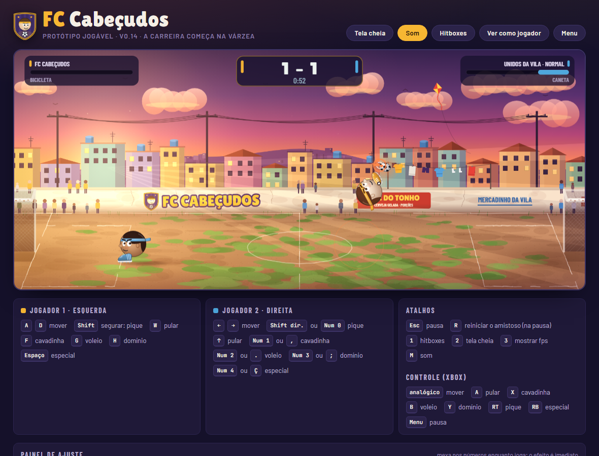

# FC Cabeçudos

Futebol de cabeça 1x1, da várzea até a final da Liga Suprema. O jogo inteiro está num arquivo só (`index.html`), sem instalação e sem dependências.

**Jogar:** https://estevanrigon.github.io/fc-cabecudos/



## Controles

- **Teclado:** A/D anda, Shift (segurar) pique, W pula, F cavadinha, G voleio, H domínio, Espaço especial, Esc pausa. O jogador 2 usa as setas e o teclado numérico.
- **Celular e tablet:** trilha de deslizar na esquerda (na ponta, pique) e botões na direita.
- **Controle de Xbox:** analógico anda, A pula, X cavadinha, B voleio, Y domínio, RT pique, RB especial, Menu pausa. Com dois controles, cada um é um jogador.

O jogo oferece um treino guiado na primeira partida, e ele fica sempre no menu.

## Rodar no computador

Dois cliques no `index.html`. Aberto assim, aparece o painel de ajuste da física embaixo do campo; o botão **Ver como jogador** mostra a versão que os amigos veem. A carreira fica salva no navegador.

## Publicar uma versão nova

O GitHub Pages serve o `index.html` da branch `main`. Cada `git push` na `main` vira a versão do link em cerca de um minuto. Trabalho em andamento fica em commit local (sem push) ou numa branch.

## Testes automáticos

Python 3 + Playwright. Na primeira vez:

```
pip install -r testes/requirements.txt
python -m playwright install chromium
```

Depois, cada teste roda sozinho e imprime OK ou FALHOU por verificação (as capturas de tela vão para `testes/capturas/`, fora do git):

```
python testes/carreira.py
python testes/fisica.py
python testes/telas.py
python testes/treino.py
python testes/especiais.py
python testes/controle.py
```

## O que tem aqui

| Arquivo | Para quê |
| - | - |
| `index.html` | o jogo |
| `CLAUDE.md` | instruções e mapa do código para o Claude Code |
| `docs/estado.md` | como cada sistema funciona e as decisões já tomadas |
| `docs/plano.md` | próximos passos, pendências e decisões em aberto |
| `docs/historico.md` | o que cada versão trouxe |
| `testes/` | testes automáticos com Playwright |

## Trabalhar com o Claude Code

Na pasta do projeto, `claude` abre o Claude Code; o `CLAUDE.md` explica para ele como o projeto funciona. Também dá para usar o Claude Code na web (claude.ai/code) direto neste repositório.
